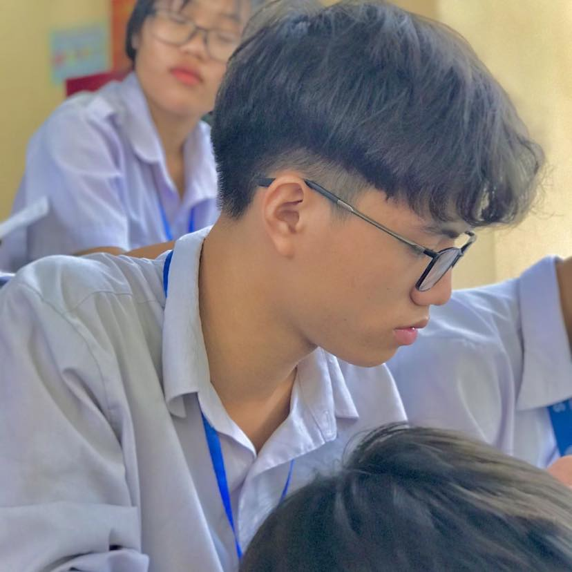

<div align="center">

# Vũ Xuân Lâm

**Software Developer · Backend · Web · Systems**

Vietnam · 🇻🇳

<br>



<br><br>

<a href="https://github.com/Vuxuanlam">
  
</a>
&nbsp;
<a href="mailto:vxlcontact143@gmail.com">
  
</a>
&nbsp;
<a href="https://www.facebook.com/iam.Iam143">
  
</a>
&nbsp;
<a href="https://www.instagram.com/lma_04_v/">
  
</a>

</div>

<br>

---


```text
Backend        ████████████████████
Web            ██████████████████░░
Systems        █████████████████░░░
Automation     ████████████████░░░░
```

---


## Stack

<div align="center">


</div>

---

## Selected work

> A collection of projects, experiments and things I've built while learning.

<table>
<tr>
<td width="50%" valign="top">

### Backend

APIs, services and application logic built around **.NET, Java and Node.js**.

</td>

<td width="50%" valign="top">

### Web

Web applications with a focus on clean interfaces and maintainable architecture.

</td>
</tr>

<tr>
<td width="50%" valign="top">

### Infrastructure

Linux servers, reverse proxies, networking, deployment and self-hosted services.

</td>

<td width="50%" valign="top">

### Tools

Small utilities and automation projects created to solve real problems.

</td>
</tr>
</table>

---
